# Лабораторная работа №9. Git
# Отчет по лабораторной работе 
**Студент:** matador541

---

## Блок на оценку 3: Базовые операции и жизненный цикл файлов

### Пункт 1. Инициализация локального репозитория и проверка статуса
* **Что делал:** Попробовал создать изолированную папку в корневой директории, но система выдала ошибку отсутствия репозитория. После этого исправил структуру: перешел в общую папку всех лабораторных работ `labs`, инициализировал в ней новый пустой Git-репозиторий командой `git init`. Настроил конфигурационные данные пользователя (имя `matador541` и email `leha.gridnev.08@bk.ru`), установил редактор `nano` по умолчанию. Далее перешел в подпапку `lab9_git`, создал файл отчета `README.md` и запустил проверку состояния репозитория.
* **Что увидел:** На первом этапе Git выдал ошибку `fatal: not a git repository`. После исправления и инициализации в нужной папке терминал вывел штатное сообщение `On branch master` и `No commits yet`. В секции неотслеживаемых файлов отобразился каталог `./`. Это означает, что Git успешно запущен и готов к работе.
* **Скриншот ошибки:** 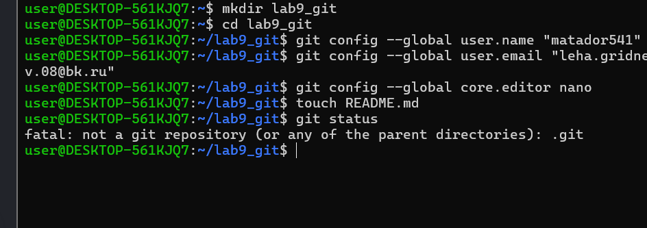
* **Скриншот правильного старта:** 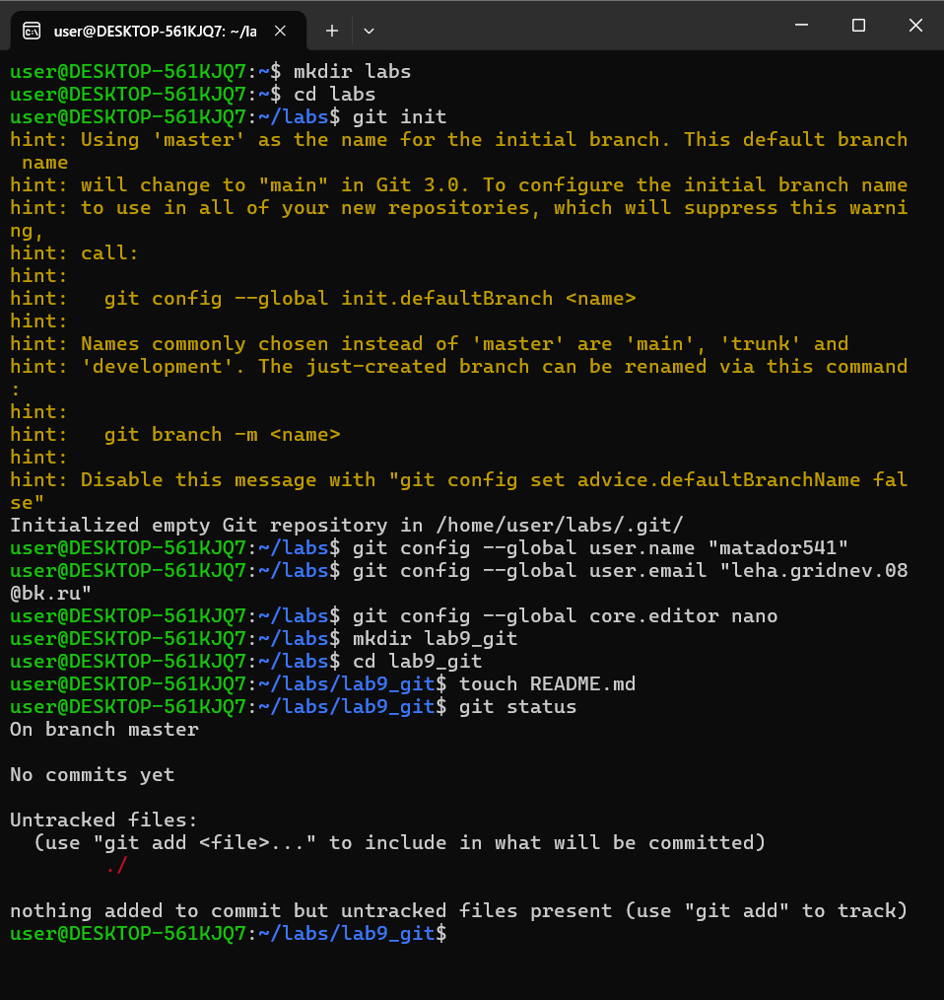

### Пункт 2. Просмотр журнала коммитов на пустом репозитории
* **What I did:** Запустил команду просмотра истории коммитов `git log`, чтобы проверить структуру логов до фиксации изменений.
* **Что увидел:** Git вернул ошибку `fatal: your current branch 'master' does not have any commits yet`. Это подтверждает, что в репозитории еще не было создано ни одной контрольной точки.
* **Скриншот:** 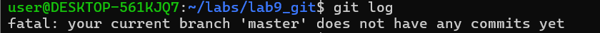

### Пункты 3-4. Создание файла исходного кода и повторная проверка статуса
* **Что делал:** Создал файл `sort.c` и через редактор `nano` написал в нем функцию сортировки массива целых чисел методом «пузырька» (Bubble Sort) на языке Си. Снова вызвал команду `git status`.
* **Что увидел:** Текст в `nano` написан корректно. После выхода в статусе репозитория файлы `README.md` и `sort.c` отобразились красным цветом в секции `Untracked files`.
* **Скриншот кода в nano:** 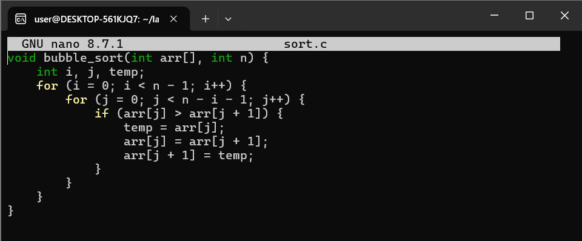
* **Скриншот статуса:** 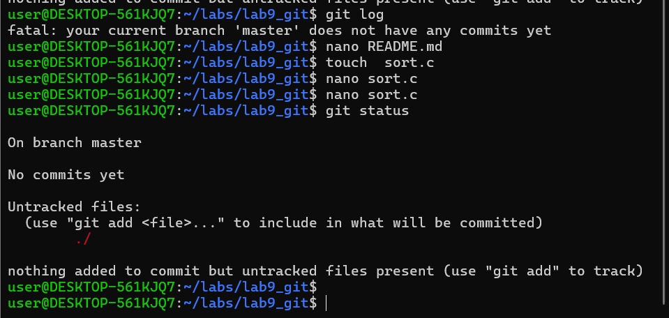

### Пункты 5-6. Индексация файла (Перенос в Staging Area)
* **Что делал:** Перевел файл с исходным кодом `sort.c` в область индексации (stage) с помощью команды `git add sort.c`. Проверил статус.
* **Что увидел:** Файл `sort.c` переместился в секцию `Changes to be committed` и стал подсвечиваться зеленым цветом с пометкой `new file: sort.c`. При этом файл отчета `README.md` остался внизу красным. Git подготовил к коммиту только то, что ему указали.
* **Скриншот:** 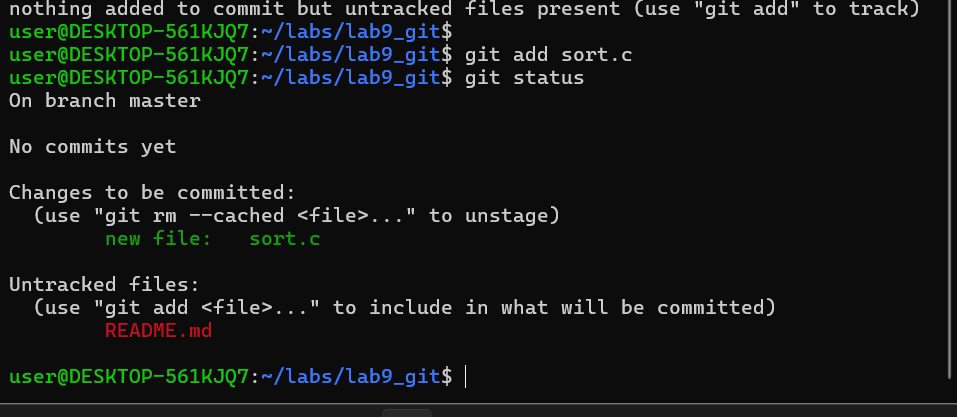

### Пункты 7-8. Создание первого коммита (Фиксация состояния)
* **Что делал:** Зафиксировал состояние подготовленного файла `sort.c` в локальной истории, выполнив команду `git commit -m "Add sort.c with bubble sort function"`. Проверил статус.
* **Что увидел:** Терминал выдал отчет о создании корневого коммита `1ef2f0a`. При вызове `git status` зеленый файл `sort.c` исчез из списка изменений, так как он успешно закоммичен.
* **Скриншот:** 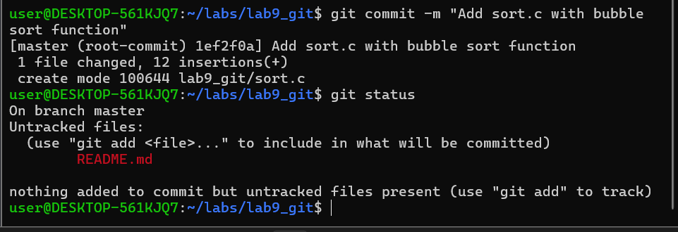

### Пункты 9-15. Исследование механизма работы индекса при повторных изменениях
* **Что делал:** Открыл файл `sort.c` через `nano` и добавил строку комментария `// Первая версия кода с сортировкой`. Сохранил и проиндексировал это изменение командой `git add sort.c`. Сразу после этого, не делая коммит, снова открыл этот же файл и изменил комментарий на `// Первая версия кода с сортировкой (исправленный комментарий)`. Запустил команду `git status`.
* **Что увидел:** Файл `sort.c` отобразился в выводе терминала одновременно в двух разных секциях: зеленым в зоне `Changes to be committed` (первая редакция комментария) и красным в зоне `Changes not staged for commit` (вторая локальная редакция комментария).
* **Вывод эксперимента:** Шаг наглядно доказал, что команда `git add` делает слепок файла именно в момент её вызова. Все последующие правки требуют повторной индексации.
* **Скриншот первой правки в nano:** 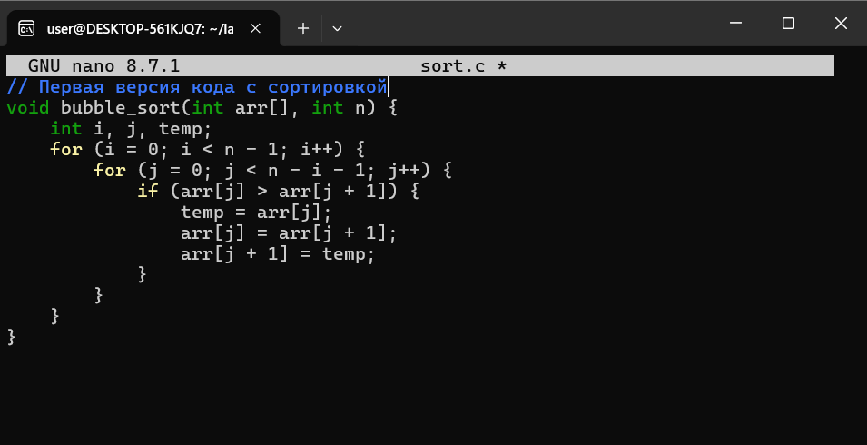
* **Скриншот второй правки в nano:** 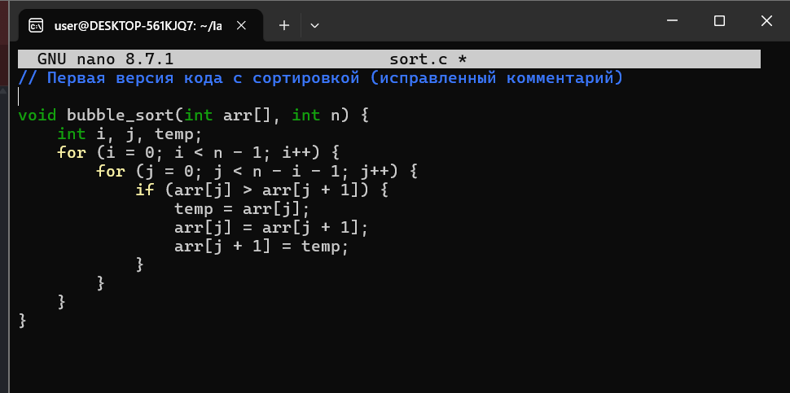
* **Скриншот двойного статуса:** 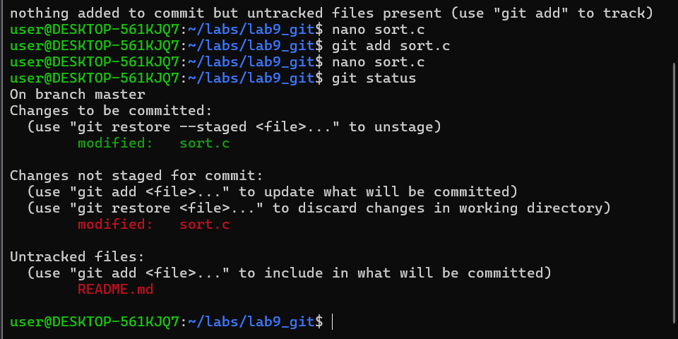

### Пункты 16-17. Синхронизация и очистка рабочей директории
* **Что делал:** Чтобы зафиксировать абсолютно все актуальные правки, повторно выполнил `git add sort.c` и закоммитил изменения с описанием `"Fix and sync all comments in sort.c"`.
* **Что увидел:** Создан коммит `e419b9c`. Рабочая директория по файлу кода стала чистой.
* **Скриншот:** 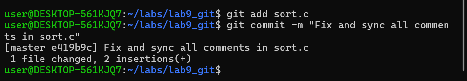

---

## Блок на оценку 4 и 5: Параллельная разработка в ветках и разрешение конфликтов слияния

### Раздел А. Создание изолированной ветки `mybranch`
* **Что делал:** Создал новую ветку командой `git checkout -b mybranch`. Внутри нее создал файл `file1.txt`, записал туда свое имя `"leha"`, добавил в индекс и сделал коммит. Затем вызвал общую историю веток в виде графа через команду `git log --oneline --graph --all`.
* **Что увидел:** На экране построился линейный граф. Я увидел, что коммит `de2c068` (ветка `mybranch`) находится на вершине истории и указывает на то, что изолированная ветка ушла на один шаг вперед относительно `master` (`e419b9c`).
* **Скриншот:** 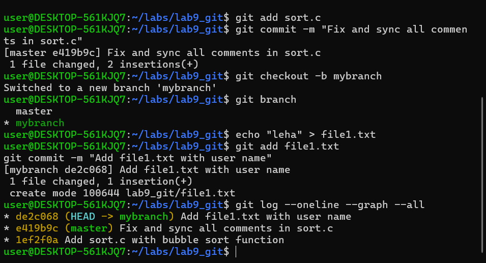

### Раздел Б. Искусственное моделирование ситуации конфликта слияния (Merge Conflict)
* **Что делал:** 
  1. Находясь в ветке `mybranch`, переписал первую строчку комментария в файле `sort.c` текстом `// Этот код был изменен внутри ветки mybranch` и сделал коммит.
  2. Переключился обратно в ветку `master` командой `git checkout master`. Изменил ту же самую первую строчку комментария на другой текст: `// Этот код был изменен внутри ветки master`. Сделал коммит.
  3. Попытался объединить ветки, находясь в `master`, с помощью команды слияния: `git merge mybranch`.
* **Что увидел:** Автоматическое слияние полностью заблокировалось. Git вывел в терминал критическое предупреждение: `CONFLICT (content): Merge conflict in lab9_git/sort.c. Automatic merge failed; fix conflicts and then commit the result`. Алгоритм Git остановил процесс, так как одна и та же строка была изменена параллельно в двух разных ветках.
* **Скриншот конфликта в консоли:** 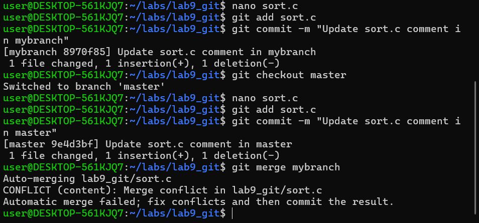

### Раздел В. Ручное разрешение конфликта и финальный коммит слияния
* **Что делал:** Открыл конфликтующий файл `sort.c` через текстовый редактор `nano`. 
  1. Обнаружил маркеры конфликта, которые вставил Git: `<<<<<<< HEAD`, разделитель `=======` и маркер `>>>>>>> mybranch`.
  2. Вручную стер все служебные маркеры и ключевые слова `HEAD` и `mybranch`.
  3. Переписал спорную строку, объединив смысл обеих веток в один аккуратный комментарий: `// Этот код был объединен из веток master и mybranch`.
  4. Сохранил файл, выполнил команду `git add sort.c` и зафиксировал итоговый коммит слияния командой `git commit -m "Merge branch mybranch and fix conflict in sort.c"`.
  5. Построил финальное дерево истории: `git log --oneline --graph --all`.
* **Что увидел:** На итоговом графе отобразилась красивая древовидная структура. Я наглядно увидел, как история коммитов разделяется на две параллельные цветные ветки, а затем обе эти линии физически сходятся в одной верхней точке — в коммите слияния `b3dbc32 (HEAD -> master)`. Конфликт успешно разрешен.
* **Скриншот маркеров конфликта:** 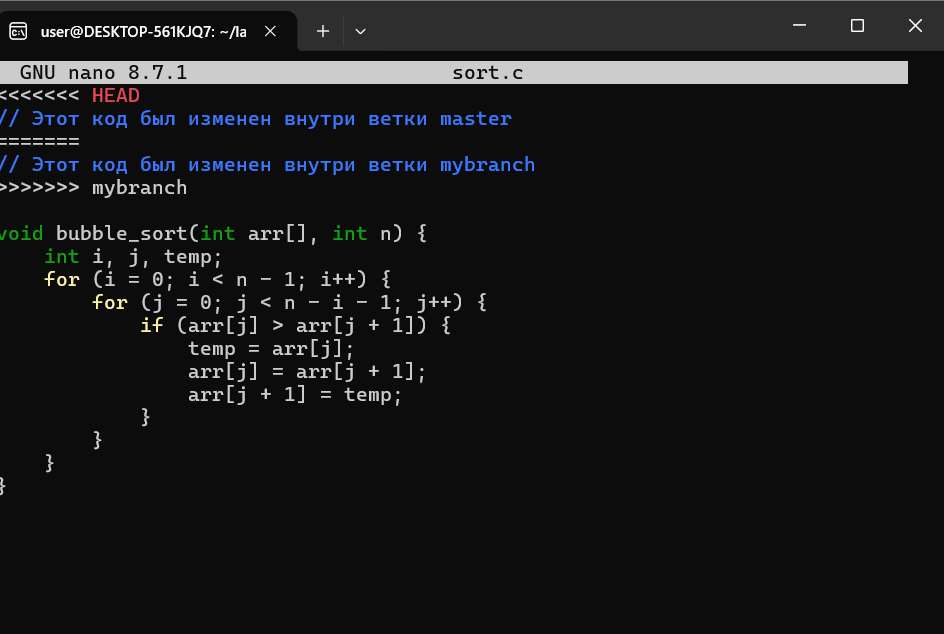
* **Скриншот процесса очистки:** 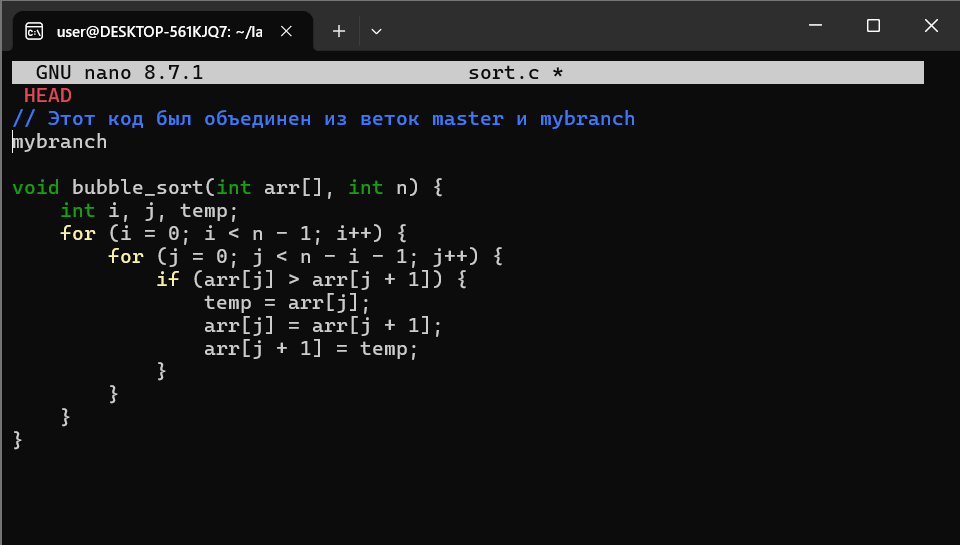
* **Скриншот финального дерева логов:** 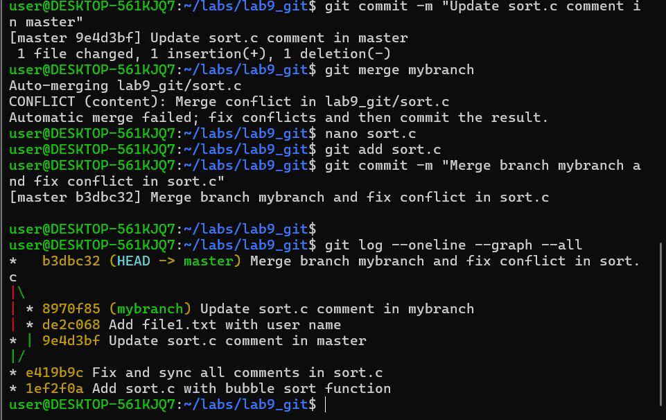

